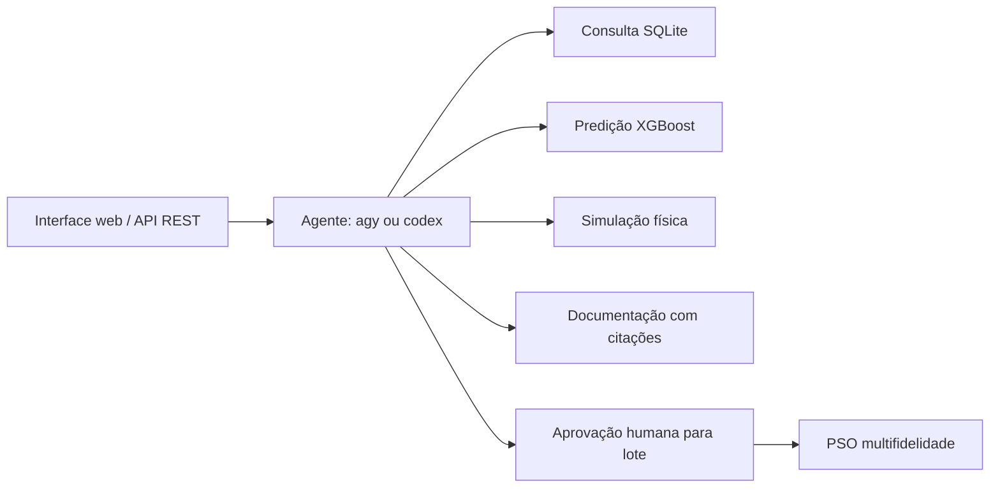

# ✈️ AeroMDO Copilot

**Assistente de IA para Engenharia Aeronáutica — SAE AeroDesign**

Aplicação web e API REST em Python/FastAPI para consultar simulações e documentação técnica, estimar desempenho com XGBoost e executar simulações e otimizações aeronáuticas. Os contratos de entrada e saída usam Pydantic.

O projeto reúne um simulador migrado de MATLAB para Python/NumPy, um pipeline de dados históricos, otimização por enxame de partículas (PSO) com surrogate e recuperação de documentação com citações. O agente atual usa os CLIs `agy` ou `codex` para selecionar ferramentas e extrair parâmetros; requer um desses CLIs instalado e autenticado.

## Funcionalidades e arquitetura

| Ferramenta do agente | Função |
|---|---|
| `query_mdo_database` | Consultar avaliações históricas em SQLite |
| `predict_surrogate` | Estimar desempenho e viabilidade com XGBoost |
| `run_physics_simulation` | Executar simulação física em Python/NumPy |
| `run_multifidelity_pso` | Otimizar geometria usando surrogate e verificações físicas |
| `search_technical_docs` | Recuperar trechos do relatório com página, seção e requisitos |



A aprovação humana é habilitada por padrão para otimizações em lote, com ticket pendente e execução por `POST /agent/approve/{ticket_id}`. Pode ser desativada pelo campo `require_human_approval_for_batch`. Simulações individuais e `POST /simulate` executam diretamente. Os tickets ficam em memória e não persistem após reiniciar o serviço. A API não implementa autenticação.

## Resultados e metodologia

Os números a seguir vêm do [relatório de métricas salvo](artifacts/metrics_report.json). Os resultados correspondem à execução registrada e ao protocolo descrito abaixo; os tempos variam conforme o ambiente. O código dos cálculos está em [surrogate.py](src/aeromdo/surrogate.py) e [evals.py](src/aeromdo/evals.py).

### Base de simulações e modelo

O pipeline consolidou **49.500 registros históricos**, dos quais **37.309 configurações únicas após limpeza**. Há 42.927 registros LLT e 6.573 AVL antes da limpeza. O split deduplicado usa 29.847 registros de treino e 7.462 de teste. O modelo recebe 16 variáveis geométricas brutas; variáveis derivadas de restrições são excluídas das entradas.

O relatório também contém validação `GroupKFold` com cinco folds agrupados por arquivo de campanha e avaliação do subconjunto AVL. Essas avaliações têm resultados diferentes do split aleatório: por exemplo, o R² de MTOW cai de 0,8919 no split deduplicado para 0,5812 entre campanhas. Os resultados não devem ser interpretados como precisão uniforme em geometrias ou campanhas inéditas.

### Aceleração de 4,44× e redução de 80% das chamadas físicas

A função `run_multifidelity_pso_benchmark` compara **três estratégias, com cinco execuções por estratégia** (15 execuções ao todo), usando as sementes `42, 101, 202, 303, 404` e arquitetura monoplano.

| Estratégia | Configuração por execução | Chamadas físicas por execução | Tempo médio | PVOO médio ± desvio padrão |
|---|---|---:|---:|---:|
| PSO totalmente físico | 20 partículas × 10 iterações | 200 | 36,57557 s | 156,2942 ± 0,5482 |
| PSO multifidelidade | 20 partículas × 10 iterações; top-4 verificados fisicamente por iteração | 40 | 8,23994 s | 153,0476 ± 1,1454 |
| PSO físico com igual orçamento | 8 partículas × 5 iterações | 40 | 7,30597 s | 153,9673 ± 1,2552 |

**Aceleração:** razão entre as médias de tempo das cinco sementes, e não média das razões individuais:

```text
speedup = tempo_médio_PSO_físico / tempo_médio_PSO_multifidelidade
        = 36575,57 ms / 8239,94 ms
        = 4,4388… ≈ 4,44×
```

O tempo é medido com `time.perf_counter()` dentro do laço de otimização. Inclui inferência, simulações e correção online por Random Forest no método multifidelidade; exclui ingestão e treinamento inicial do XGBoost, carregamento do modelo e chamadas ao roteador LLM. O ganho é do método completo assistido por surrogate, não uma medição isolada de inferência do XGBoost. O artefato não registra hardware nem tempos individuais por semente, limitando a análise da variação temporal.

**Redução das chamadas ao simulador físico:**

```text
PSO físico:          20 × 10 = 200 chamadas por execução
PSO multifidelidade:  4 × 10 =  40 chamadas por execução
redução = (200 − 40) / 200 × 100 = 80%
```

Nas cinco sementes, são 1.000 contra 200 chamadas físicas. O multifidelidade também avalia 200 candidatos pelo surrogate por execução; essas avaliações não entram na contagem de chamadas físicas.

**Qualidade da solução:** o multifidelidade reteve `153,0476 / 156,2942 × 100 = 97,92%` do PVOO médio do PSO físico de 200 chamadas. O controle físico de igual orçamento foi mais rápido e teve PVOO médio cerca de 0,6% maior que o multifidelidade. Portanto, 4,44× se refere exclusivamente ao baseline de 200 chamadas, sem evidência de superioridade sobre o controle de 40 chamadas. Os desvios da tabela são populacionais (`numpy.std`, `ddof=0`), não intervalos de confiança nem teste de equivalência estatística.

### Hit@5 por página de 96% e abstenção de 100%

A avaliação usa **31 perguntas fixas**: **25 técnicas**, com páginas esperadas anotadas, e **6 fora de escopo**. O corpus contém **76 trechos extraídos do PDF do Relatório de Projeto Conceitual, Preliminar e Integração 2026**. As perguntas e os rótulos estão em `RAG_BENCHMARK_QUESTIONS` e `OUT_OF_SCOPE_QUESTIONS`, em [evals.py](src/aeromdo/evals.py).

O recuperador combina similaridade TF-IDF de palavras (peso 0,65) e caracteres (0,35), com bônus para códigos de requisitos e referências a tabelas/seções. As respostas apresentam excertos e citações; essa avaliação não exige um LLM.

**Critério de acerto:** para cada pergunta técnica, recuperar até cinco trechos e verificar se pelo menos uma página citada pertence ao conjunto de páginas esperado.

```text
Hit@5 por página = perguntas com ao menos uma página esperada entre as cinco citações / 25
                 = 24 / 25 = 96%
baseline lexical = 23 / 25 = 92%
```

Embora o código nomeie a métrica `hybrid_rag_recall_at_5`, operacionalmente ela é uma **taxa de acerto por pergunta (Hit@5) por página**. Não mede a fração de todos os trechos relevantes recuperados nem a correção integral da resposta. Quando uma pergunta tem várias páginas esperadas, basta acertar uma delas. Uma abstenção em pergunta técnica conta como erro.

**Abstenção:** uma pergunta fora de escopo só conta como sucesso quando a resposta tem `abstained=True` **e nenhuma citação**:

```text
abstenção fora de escopo = respostas abstidas sem citações / perguntas fora de escopo
                        = 6 / 6 = 100%
```

O recuperador se abstém quando não há citações ou a maior pontuação é inferior ao limiar padrão `0.12`. As seis perguntas cobrem culinária, Kubernetes, futebol, investimentos e turismo. O resultado se limita a esse conjunto pequeno e fixo; não demonstra ausência geral de alucinações nem generalização para qualquer pergunta fora de escopo. Não há separação documentada entre perguntas usadas para calibrar o recuperador e perguntas finais de teste.

A taxa de formatação de citações foi 24/25 = 96%; o teste verifica presença de citações, ausência de abstenção e o marcador `Pág.` no texto, não uma auditoria completa de fidelidade factual.

### Paridade numérica MATLAB → Python

O relatório registra **uma geometria de monoplano e dez grandezas comparadas** com referências atribuídas à execução do MATLAB original em GNU Octave 11.3.0. O erro relativo é `100 × abs(Python − referência) / abs(referência)`.

| Grandeza | Referência Octave | Python registrado | Erro relativo registrado |
|---|---:|---:|---:|
| MTOW (kg) | 11,650391 | 11,646500 | 0,0334% |
| Peso vazio (kg) | 2,890589 | 2,890600 | 0,0004% |
| CL máximo em voo | 1,589533 | 1,589500 | 0,0021% |
| CL máximo em solo | 1,643721 | 1,643700 | 0,0013% |
| Cm0 | 0,072176 | 0,072180 | 0,0055% |
| Cmα | −0,038022 | −0,038020 | 0,0053% |
| Margem estática | 0,453498 | 0,453500 | 0,0004% |

O maior erro registrado nas dez grandezas é inferior a 0,04%. O [teste de paridade](tests/test_physics.py) compara o simulador Python com constantes de referência, usando tolerâncias absolutas; não executa Octave nem impõe diretamente o limite relativo de 0,04%. O bloco de paridade em `build_all.py` é estático. Isso sustenta a comparação registrada para essa geometria, não uma campanha de validação de múltiplas geometrias.

### Avaliação do agente e testes

O conjunto de avaliação do agente contém **23 casos canônicos e 18 prompts conversacionais**. Os testes automatizados usam respostas simuladas dos CLIs para verificar a integração das ferramentas, os contratos de dados e o fluxo de aprovação humana, sem depender de serviços externos.

A precisão de roteamento dos provedores atuais deve ser medida separadamente, com o CLI autenticado. As métricas de agente presentes no relatório salvo pertencem a uma versão anterior do roteador e não se aplicam à integração atual.

O [workflow do GitHub Actions](.github/workflows/ci.yml) executa testes de física/paridade e testes independentes de API e comportamento do agente. A suíte completa inclui testes de RAG, modelos e integração que exigem o banco e os modelos gerados localmente; eles não rodam no CI público sem esses insumos.

## Execução com Nix

```bash
nix develop

# Testes independentes dos dados externos e de autenticação dos CLIs
pytest tests/test_physics.py tests/test_api_contracts.py

# API, interface web em / e documentação interativa em /docs
uvicorn aeromdo.api:app --reload
```

A interface abre em `http://127.0.0.1:8000`. Sem dados/modelos, a simulação física e os testes independentes funcionam; consultas históricas, RAG e predições exigem preparar os artefatos abaixo. O chat também exige `agy` ou `codex` disponível no PATH e autenticado. O flake fornece o ambiente Python, mas não instala nem autentica esses CLIs.

### Dados necessários e reconstrução

As planilhas, o PDF e o código MATLAB original não estão versionados neste repositório. O SQLite e o bundle treinado também são ignorados pelo Git. Para reconstruir as métricas, obtenha os insumos da equipe e configure o diretório de entrada:

```text
data/raw/
├── TESTES_MDO/*.xlsx
├── individuos.xlsx
└── Relatorio_de_Projeto_Conceitual_Preliminar_e_Integracao_2026.pdf
```

```bash
# Dentro de nix develop; o diretório padrão é data/raw
export AEROMDO_RAW_DIR="/caminho/para/os/insumos"
export AEROMDO_LLM_PROVIDER=agy  # ou codex, instalado e autenticado
python3 scripts/build_all.py
pytest -v
```

O build ingere os dados, treina os modelos, executa as 15 otimizações e avalia RAG e agente. Ele sobrescreve `artifacts/metrics_report.json`; preserve o relatório histórico se precisar comparar execuções. Os tempos podem mudar. A paridade Octave continua sendo uma referência estática, não é recalculada pelo build.

Para repetir apenas a avaliação RAG após gerar o banco:

```bash
python3 - <<'PY'
import json
from aeromdo.evals import evaluate_rag_suite
from aeromdo.rag import AeroRAGIndex
print(json.dumps(evaluate_rag_suite(AeroRAGIndex(), top_k=5), indent=2))
PY
```
