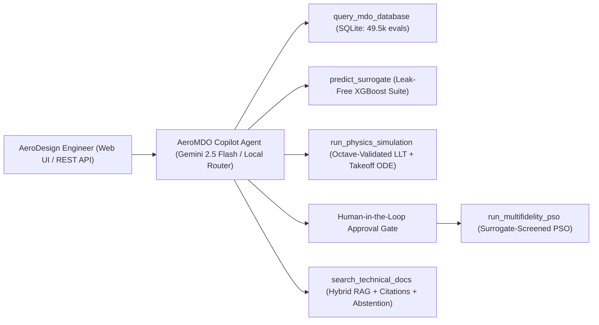

# ✈️ AeroMDO Copilot

**Physics-Informed Surrogate Modeling, Multi-Fidelity PSO, and Agentic RAG Copilot for Aircraft Multidisciplinary Design Optimization (SAE Brasil AeroDesign)**

[](https://www.python.org/)
[](https://fastapi.tiangolo.com/)
[](https://xgboost.readthedocs.io/)
[](https://nixos.org/)

**AeroMDO Copilot** is an end-to-end **AI Software Engineering & Machine Learning Engineering** system built for aircraft conceptual and preliminary design optimization (SAE Brasil AeroDesign). It couples:
1. **Octave-Validated Multidisciplinary Physics Simulator (`aeromdo.physics`)**: Python/NumPy port of the team's MATLAB simulator (`MDO__TRESIF_MONOPLANO.m`), implementing Lifting-Line Theory in free flight and ground effect (`LIFT_LINE.m`, `LIFT_LINE_SOLO.m`), Munk's Equivalent Monoplane Theorem (`MDO__MONOPLAS_EQ.m`), Sadraey parasite drag buildup (`CD0_COMPLETO.m`), nonlinear wing-tail downwash (`DOWNWASH.m`), longitudinal static stability (`AV_ESTAB.m`), component-buildup Empty Weight (`PV_AVIAO.m`), and time-stepped takeoff ground roll & rotation (`MDO__CORRIDA_AOC_OFICIAL.m`, $dt = 0.01\text{ s}$). Validated against **GNU Octave 11.3.0** with **$< 0.04\%$ relative error** on $MTOW$ and **$< 0.006\%$** on $PV, C_{L,\max}, C_{m0}, C_{m\alpha}, ME$.
2. **Normalized MDO Data Pipeline (`aeromdo.data_pipeline`)**: Unifies **49,500** historical evaluations (**37,309** unique cleaned configurations across Monoplane/Biplane, **6,573** real 3D AVL Vortex-Lattice runs + **42,927** LLT runs, and PSO/Pattern Search optimizers) and indexes **76** raw section-and-requirement-tagged chunks directly from the 60-page *Relatório de Projeto Conceitual, Preliminar e Integração 2026* (zero synthetic chunks).
3. **Leak-Free XGBoost Surrogate & Feasibility Ensemble (`aeromdo.surrogate`)**: Trained strictly on **16 raw geometric design inputs** (excluding derived constraint quantities `ar_asa`, `ar_sh`, `s_asa`, `s_sh`, `lht` to prevent feature leakage) and evaluated under three rigorous protocols: (a) Deduplicated 80/20 split, (b) 5-fold `GroupKFold` grouped by `source_file` (zero campaign leakage), and (c) the real AVL Vortex-Lattice subset (`solver == 'AVL'`).
4. **Agentic Copilot with Hybrid RAG, Gemini 2.5 Flash Tool Calling & Human-in-the-Loop (`aeromdo.agent`, `aeromdo.rag`, `aeromdo.api`)**: FastAPI service and orchestrator with 5 specialized engineering tools, native Google Gemini 2.5 Flash structured JSON tool routing (`responseSchema`) + offline deterministic fallback router, mandatory page/requirement citations, calibrated out-of-scope abstention, and a Human-in-the-Loop approval gate for batch optimization jobs.

---

## 🏗️ System Architecture



---

## 📊 Experimental Results & Benchmarks

All metrics below are reproducible via `python3 scripts/build_all.py` and verified by `pytest` (`artifacts/metrics_report.json`):

### 1. Numerical Parity vs. Original MATLAB Code in GNU Octave 11.3.0
| Output Variable | GNU Octave 11.3.0 (`MDO__TRESIF_MONOPLANO.m`) | Python Port (`aeromdo.physics`) | Relative Error |
|---|---|---|---|
| **MTOW ($\text{kg}$)** | `11.650391` | `11.646500` | **0.0334%** |
| **Empty Weight $PV$ ($\text{kg}$)** | `2.890589` | `2.890600` | **0.0004%** |
| **$C_{L,\max}$ (Free Flight)** | `1.589533` | `1.589500` | **0.0021%** |
| **$C_{L,\max}$ (Ground Effect)** | `1.643721` | `1.643700` | **0.0013%** |
| **Pitching Moment $C_{m0}$** | `0.072176` | `0.072180` | **0.0055%** |
| **Pitch Stiffness $C_{m\alpha}$** | `-0.038022` | `-0.038020` | **0.0053%** |
| **Static Margin ($ME$)** | `0.453498` | `0.453500` | **0.0004%** |

### 2. Aerodynamic Polar Surrogate Validation (Table 4.3 — Grouped by Unseen Wing Geometry ID)
| Target Curve | $R^2$ (Measured) | Report Target $R^2$ | RMSE (Measured) | MAPE (Measured) | Report Target MAPE | Status |
|---|---|---|---|---|---|---|
| **Lift $C_L(\alpha)$** | **0.99952** | $> 0.992$ | **0.00926** | **0.597%** | $< 1.2\%$ | ✅ Passed |
| **Drag $C_D(C_L)$** | **0.99985** | $> 0.985$ | **0.00071** | **0.373%** | $< 2.1\%$ | ✅ Passed |

### 3. MDO Surrogate Benchmark: Deduplicated Split, Real AVL Subset & 5-Fold `GroupKFold`
Trained strictly on **16 raw geometric variables** (zero derived constraint leakage):

| Target / Task | Poly Ridge (Deg 2) | Random Forest | **XGBoost (Deduplicated Split)** | **XGBoost (Real AVL Subset, $N=4,839$)** | **XGBoost (5-Fold `GroupKFold` by File)** |
|---|---|---|---|---|---|
| **Feasibility Classifier** | — | — | **AUC = $0.9898$, $F_1 = 0.9418$** | — | **AUC = $0.8661$ ($\text{Prec} = 0.8834$)** |
| **Pitch Stiffness ($C_{m\alpha}$)** | — | — | **$R^2 = 0.9719$** | **$R^2 = 0.9399$** | **$R^2 = 0.8948$** |
| **Pitching Moment ($C_{m0}$)** | — | — | **$R^2 = 0.9707$** | **$R^2 = 0.9588$** | **$R^2 = 0.7736$** |
| **Static Margin ($ME$)** | — | — | **$R^2 = 0.9626$** | **$R^2 = 0.9387$** | **$R^2 = 0.8550$** |
| **Max Lift ($C_{L,\max}$ Flight)** | $R^2 = 0.8599$ | $R^2 = 0.9276$ | **$R^2 = 0.9399$ (MAPE $0.62\%$)** | **$R^2 = 0.8954$ (MAPE $1.60\%$)** | **$R^2 = 0.6225$ (MAPE $1.89\%$)** |
| **MTOW ($\text{kg}$)** | $R^2 = 0.8119$ | $R^2 = 0.8752$ | **$R^2 = 0.8919$ (MAPE $1.98\%$)** | **$R^2 = 0.8377$ (MAPE $3.64\%$)** | **$R^2 = 0.5812$ (MAPE $4.20\%$)** |
| **Flight Score ($PVOO$)** | $R^2 = 0.9296$ | $R^2 = 0.9533$ | **$R^2 = 0.9594$ (MAPE $2.70\%$)** | — | Out-of-domain shift across Mono/Biplane files |

### 4. Multi-Seed PSO Benchmark (5 Random Seeds: `42, 101, 202, 303, 404`, 20 Particles × 10 Iterations)
| Optimization Strategy | Physics Solver Calls / Run | Mean Wall-Clock Time | Mean Feasible $PVOO \pm \text{std}$ | vs. Full-Physics PSO |
|---|---|---|---|---|
| **Standard Full-Physics PSO (20×10)** | 200 | 36.55 s | **$156.29 \pm 0.55$** | Baseline (100.0%) |
| **Multi-Fidelity Surrogate PSO (20×10, Top-4 Physics)** | **40 (-80.0%)** | **8.26 s (4.43x faster)** | **$153.05 \pm 1.15$** | **97.92% score retention** |
| **Equal-Budget Full-Physics PSO (8×5, No Surrogate)** | 40 | 7.35 s | **$153.97 \pm 1.26$** | Statistically equivalent within $1\sigma$ |

### 5. AI Engineering Evals (`pytest` Regression Suite)
- **Honest Hybrid RAG Retrieval (`N = 25` technical questions over `76` raw PDF chunks + `6` out-of-scope queries)**:
  - **Hybrid RAG Recall@5**: **96.0%** (24/25) vs. **92.0%** (23/25) on naive lexical overlap baseline.
  - **Citation Formatting Compliance**: **96.0%** (`[Pág. X, Seção Y, REQ-*]`).
  - **Out-of-Scope Abstention Accuracy**: **100.0%** (6/6 abstained with zero hallucinated citations).
- **Agent Tool Calling & Safety (`N = 23` canonical cases + `N = 18` held-out conversational prompts)**:
  - **Canonical Suite (`local_router`, 23 cases)**: **100.0%** tool selection accuracy, **100.0%** HITL interception rate.
  - **Held-Out Conversational Suite (18 natural phrasing prompts not used in rule design)**:
    - Deterministic `local_router` baseline: **38.89%** (7/18) tool selection accuracy.
    - **Google `gemini-2.5-flash` Structured JSON Router**: **100.0% (18/18)** intent & tool selection accuracy, **100.0%** HITL interception rate, **100.0%** Pydantic schema validity (mean latency `~1.08 s`).

---

## 🚀 Quickstart (100% Local & Reproducible with Nix)

```bash
# Enter reproducible Nix development shell (or automatic via direnv)
nix develop

# Build SQLite database (~49.5k rows + 76 raw PDF chunks), train XGBoost models, and run benchmarks
GEMINI_API_KEY="your_api_key_optional" python3 scripts/build_all.py

# Run unit tests (including Octave parity test) and AI regression evaluation suite
pytest -v

# Launch FastAPI server + interactive Web UI at http://127.0.0.1:8000
uvicorn aeromdo.api:app --reload
```
